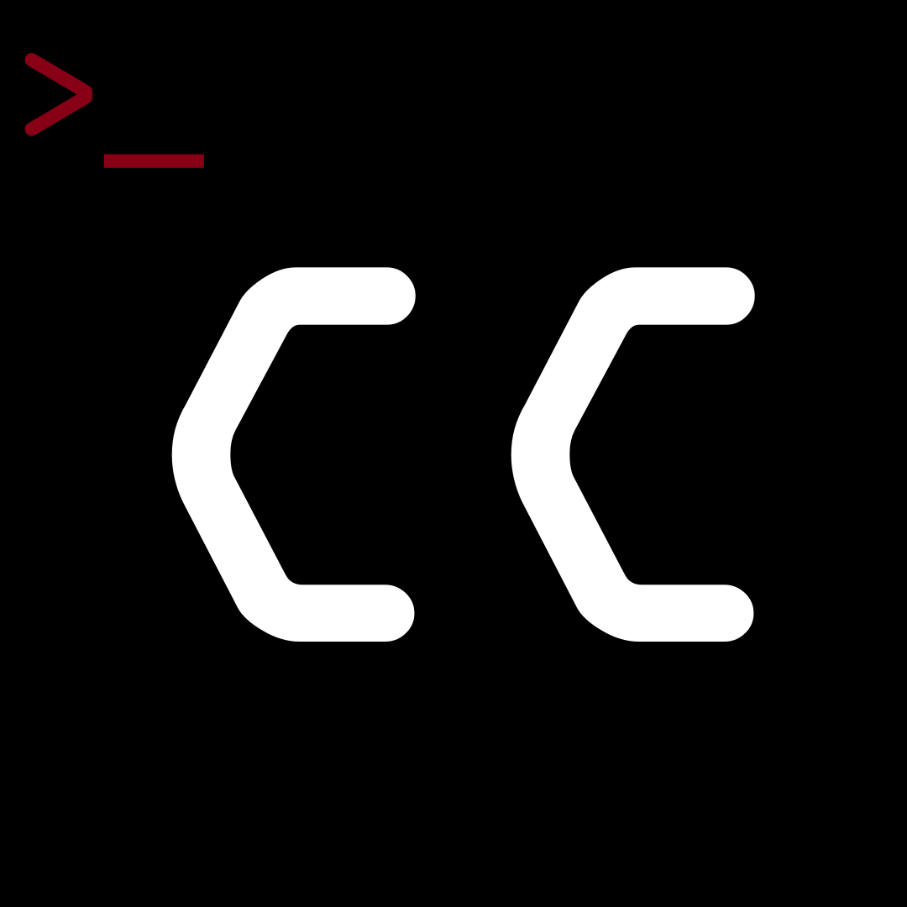

# ChampionsCode



A **client-side Fabric mod for Minecraft Java Edition 26.3** that provides an
msfconsole-inspired workflow for authorized, defensive server/plugin research,
plus an explicitly enabled runtime Java addon development system.

> **Status:** `0.1.0-beta.3` - third beta (re-release of beta.2 with fixed release publishing). The project builds, tests,
> and produces an installable Fabric JAR. It includes packet-flow, metadata
> replay, inventory-integrity, passive transaction-flow, client-resilience,
> passive motion, bounded older-project ports, a separately warned
> exploit-research workspace, and plug-and-play exploit and payload drop-in
> folders.

## What is implemented

### Research console

Press **F8** in game to open the movable ChampionsCode terminal. Its dark shell,
colored output, prompt, and title bar follow a familiar Linux terminal layout.
Drag the title bar to move it, drag the bottom-right corner to resize it, and use
the top-right minimize, maximize, and close controls. Terminal output remains
mouse-selectable and can be copied with Ctrl+C.

All UIs live together in one windowed workspace: press **F8** for the terminal,
**F7** for the Java Studio, **F6** for the game log viewer, run `clickgui` for the
sorted-list interface (where the warning-gated **Exploits** filter remains
available), `categorygui` for the movable category-window interface, or `logs`
for the log viewer. Every UI is an independent window that stays open next to
the others - open the terminal, pull the ClickGUI alongside it, and add Java
Studio, the log viewer, or the category panels, all visible and usable at once.
Each window keeps its own drag, resize, minimize, maximize, and close controls;
F6/F7/F8 toggle their window while the workspace is open, and ESC (or closing
the last window) closes the whole workspace. All three keybinds can be rebound
under the ChampionsCode controls category. All custom drag handlers use Minecraft 26.3's
one-based mouse-button values. None of these screens dim the world behind them
while open, and the main menu carries a small ARMED identification box with the
installed version.

- `clickgui`, `categorygui`, `show modules`, `search`, `use`, `info`, `show options`
- `set`, `unset`, `run`, `back`, `status`, `reload`, `exit` (closes the terminal)
- `logs` (also `log`) opens the live game log window described below
- `update check`, `update download <version>` (see [Updates](#updates))
- Sorted-list ClickGUI with a module search box, structured option editors, a
  recently-seen players dropdown (including players who left) for player
  identity options, dropdowns for fixed-choice options (for example the chat
  plugin enumerator's MODE), confirmation arming, explicit run status, and run
  controls. Dropdowns stay on screen (clamped and flipped when space runs out)
  and option labels never run under their editors.
- Multi-window category GUI with independently movable, collapsible, and resizable category panels
- `auxiliary/lookup/player_identity` accepts a username or UUID in either input
  field: pasted UUIDs are detected and routed automatically, so a UUID that ends
  up in the username field still resolves
- Module registry with typed options and structured findings
- Exact-host authorization allowlist
- One-run `CONFIRM` phrase
- Append-only JSONL audit log
- Startup update notice and SHA-256-verified update downloads
- Command history, scrolling, colors, and redaction of the confirmation phrase

Included modules:

| Module | Purpose |
|---|---|
| `auxiliary/scanner/server_fingerprint` | Reports metadata already disclosed to the connected client. |
| `auxiliary/scanner/server_ping` | Opens one standard status ping to the currently authorized, allowlisted server and reports what any unauthenticated server-list pinger can see without joining: protocol, MOTD, player counts and sample, chat-security flags, and mod-platform disclosure. No ranges or third-party hosts. |
| `auxiliary/lookup/player_identity` | Resolves one username or UUID via Mojang's public profile API (current name, dashed UUID, skin/cape textures). Contacts only Mojang endpoints, never the connected server. |
| `auxiliary/audit/connection_posture` | Reviews passive session and transport indicators. |
| `auxiliary/audit/plugin_surface` | Inventories command roots advertised to the current player. It does not execute them or claim conclusive plugin detection. |
| `auxiliary/audit/plugin_risk_review` | Maps advertised roots to non-conclusive defensive review profiles without sending commands. |
| `auxiliary/audit/dependency_posture` | Reviews a bounded administrator-supplied `name@version` inventory for missing pins, conflicts, and moving builds. |
| `auxiliary/audit/chat_normalization` | Canonicalizes one local sample for defensive filter testing without generating bypass variants or sending chat. |
| `auxiliary/audit/chat_game_fairness` | Classifies one supplied game prompt and reports automation exposure without solving or answering it. |
| `auxiliary/exploits/research_workspace` | Records scope, authorization basis, expected impact, and stop conditions without executing an exploit. It carries the extra popup gate. |
| `auxiliary/scanner/chat_plugin_enumerator` | Filters default commands. SILENT marks non-default roots without sending; AGGRESSIVE probes only safe advertised blank/version/v paths and captures bounded responses. |
| `auxiliary/observe/wire_lens` | Aggregates packet class names, directions, rates, and bursts without retaining payloads. |
| `auxiliary/replay/session_trace` | Renders a bounded packet-metadata timeline for ordering analysis; it cannot reinject traffic. |
| `auxiliary/audit/container_integrity` | Reviews menu IDs/state, slots, carried stacks, item-component density, and inventory flow. |
| `auxiliary/observe/transaction_echo` | Passively correlates menu-action and menu-update packet classes for coarse response timing, without retaining IDs or slot data. |
| `auxiliary/audit/client_resilience` | Warns about packet-rate bursts, custom-payload concentration, connection errors, and timeline pressure. |
| `auxiliary/observe/motion_evidence` | Passively summarizes broad remote-player motion evidence without verdicts, reporting, or punishment. |
| `auxiliary/exploits/example_preflight` | Drop-in example for the exploit folder: passively reviews the session snapshot and sends nothing. |
| `auxiliary/payloads/example_plan` | Drop-in example for the payload folder: builds bounded payload variants in memory and reports the plan without dispatching. |

### Game log viewer

Press **F6**, or run `logs` in the terminal, to open the log window: a live tail
of the running game's own output log, `logs/latest.log` in the game directory
(the same file the launcher's log window shows), read incrementally so only what
the game appended since the last poll is decoded. The window is a normal
workspace window - drag it by the title bar, resize it from the bottom-right
grip, minimize, maximize, and keep it open beside the terminal and the other
panels.

Search is the point of the window:

- typing in the search field filters and highlights **every** occurrence in the
  buffered log, in place, while the window keeps following the game
- **Enter** jumps to the next match, **Shift+Enter** to the previous one, and the
  `Prev`/`Next` chips do the same with a `[n/total]` counter in the status bar
- `Aa` toggles case sensitivity, `Only` hides every line that does not match
- `Level: ALL` cycles a minimum-level filter (ALL -> INFO -> WARN -> ERROR);
  stack-trace continuation lines have no level of their own and stay visible
  under every filter, so an error never loses its cause
- `Live` returns to the newest line: the window follows the end of the log
  (`tail -f` style, header shows LIVE) until you scroll away from the bottom, and
  then new lines keep arriving without moving your view (header shows PAUSED).
  `End` jumps back to the newest line, `Home` to the oldest buffered one
- clicking a line selects it, dragging extends the selection, and **Ctrl+C**
  copies the selection - or every matching line, or the whole 4 000-line buffer
  when nothing is selected or searched. The status bar confirms what was copied
- lines are colored by level (WARN yellow, ERROR/FATAL red, debug dimmed) and
  error/warning lines get a marker stripe in the gutter, next to their line
  number

The buffer keeps the newest 4 000 lines; older ones are dropped as the log
grows, which the status bar reports. When the game rotates the file (a new
launch replaces `latest.log`), the window notes the rotation and keeps reading
the new file instead of blanking out.

### Drop-in exploit and payload folders

Active security-test files live in two plug-and-play packages inside the
client source set:
`src/client/java/com/internationalduck/championscode/module/exploit/` for
exploit research and server-boundary tests, and
`src/client/java/com/internationalduck/championscode/module/payload/` for
bounded payload builders and inspectors. Each folder carries a fully
commented `Example...Module.java` template plus a `package-info.java` with
its conventions. Registered drop-ins are wired from the `ChampionsClient`
entrypoint through `ChampionConsole.registerModule(...)`, because the core
`ModuleRegistry` cannot see the client source set. See
[`docs/exploit-and-payload-files.md`](docs/exploit-and-payload-files.md) for
the layout, plug-and-play rules, and registration path.

### Telemetry boundaries

The client keeps a fixed 512-entry rolling timeline containing only packet
**direction, Java class name, and timestamp**. Packet bodies, chat text, NBT,
credentials, and encryption material are not stored. Old entries are evicted.
The session-trace module displays this metadata but cannot resend it.

Container telemetry reads the already-visible local menu state without clicking,
closing, delaying, duplicating, or fabricating inventory packets. Transaction
Echo pairs packet class/timing metadata only: container IDs, state revisions,
slots, items, and payloads remain unavailable, so it cannot establish desync or
exploitability. Motion evidence uses rendered remote-player positions and
intentionally broad thresholds; lag, teleports, vehicles, and interpolation can
explain its notes.

### Exploit research workspace

The red **Exploits** workspace remains available as a ClickGUI filter and as an
`exploits` category window, but it is no longer a terminal tab. Entering it
requires a modal acknowledgement
that exploit research can create legal, contractual, privacy, availability, and
data-integrity risk. Every exploit-research module run displays a fresh warning
popup, then revalidates exact-target authorization and the one-run `CONFIRM`
phrase. Entry acknowledgements, cancellations, and per-run decisions are audited.

The workspace currently contains `auxiliary/exploits/research_workspace`, a
non-executing intake checklist for an engagement ID, legal basis, scope,
expected impact, and stop conditions, plus
`auxiliary/exploits/example_preflight`, the passive example module from the
exploit drop-in folder. Future modules use the `ExploitResearchModule` marker
to inherit the extra gate. The tab does not weaken the existing module capability boundary
or permit credential theft, destructive payloads, unauthorized scanning, stealth,
chat-filter bypasses, packet fabrication, anticheat evasion, or arbitrary command
execution.

See [`docs/exploit-research.md`](docs/exploit-research.md) for the research intake
format and implementation review requirements.

### Runtime Java addons

Press **F7** to open the dedicated, movable ChampionsCode Java Studio. Its
purple IDE-style layout has a workspace file list, multiline source editor,
runtime console, command field, lifecycle actions, and desktop-style window
controls. Changes can be saved with the **Save file** button or Ctrl+S. Only
`.java` files and `champion-java.json` inside the runtime workspace are editable.

The studio compiles real `.java` files from
`.minecraft/config/champions-mod/java/` with the standard JDK 25 compiler. All
sources are compiled together, loaded through a fresh classloader, and started
through the `ChampionRuntimeAddon` interface. Saving a file changes the source
hash and therefore invalidates the previous confirmation. Explicit reload calls
`stop()`, runs registered cleanup callbacks, closes the old classloader, compiles
the replacement, and invokes the new `start()` on the client thread.

```text
java status
java sources
java classpath
java hash
java confirm <current-sha256>
java compile
java start
java reload
java stop
```

Runtime Java is **unrestricted code execution inside Minecraft**. It is not a
sandbox and can access game internals, packets, files, credentials, networking,
reflection, process APIs, native libraries, and other loaded mods. The feature
is disabled by default, requires a full JDK 25, and requires both
`developerMode=true` and confirmation of the exact current source-set SHA-256.
Any source or manifest change invalidates that confirmation.

## Safety model

ChampionsCode is designed for systems you own or are explicitly authorized to
assess.

1. Passive modules only receive an immutable snapshot of data already available
   to the current Minecraft client.
2. The active runtime cannot send arbitrary console input. It revalidates every
   root against the live advertised command tree, filters vanilla/Bukkit/default
   and hazardous roots, and permits only blank, `version`, or `v` probe variants.
   Blank probes are rejected for roots executable without arguments.
3. AGGRESSIVE probes run sequentially, at most two per second, across no more
   than 12 candidate roots with bounded response windows.
4. `RHOST` must be `CURRENT` or exactly match the active connection.
5. The connected host must be authorized in game with `authorize current` or the ClickGUI; wildcards are rejected.
6. `CONFIRM` must be set to `I_HAVE_AUTHORIZATION` for each module run, and is
   consumed afterward.
7. Runs are recorded in `audit.jsonl` without secret option values.
8. Older-project ports are clean-room defensive rewrites. Plugin matches are
   leads rather than vulnerability claims; chat tools neither evade filters nor
   answer games; dependency review uses only bounded administrator-supplied text.
9. Entering an Exploits interface and every exploit-research run require separate
   legal-risk acknowledgements. Per-run acknowledgement never replaces target
   authorization, scope, one-run confirmation, or audit logging.

The research modules intentionally do **not** include exploit delivery,
credential or token collection, stealth, arbitrary remote scanning, packet
fuzzing, arbitrary command execution, permission/namespace bypasses, or
destructive checks. Runtime Java is a separate, local developer feature with an
explicit unsafe-mode and source-hash gate; once started, its code is unrestricted
and is outside the module capability boundary.

## Requirements

- Minecraft Java Edition **26.3**
- Fabric Loader **0.19.5+**
- Fabric API **0.161.0+26.3**
- Java **25**; a full **JDK 25** is required for runtime Java compilation

This is a normal client-side Fabric mod with no server-side component or
companion process. It runs alongside other compatible Fabric mods and requires
only one runtime JAR in the `mods` folder.

### Which release file should I download?

GitLab releases contain two JAR files, but only one is the playable mod:

| Release file | Purpose | Put in `mods`? |
|---|---|---|
| `champions-mod-<version>.jar` | Compiled Fabric mod used by Minecraft. | **Yes** |
| `champions-mod-<version>-sources.jar` | Readable Java sources for IDE navigation, debugging, and developers. It is not a second mod. | **No** |

Players should download the plain `champions-mod-<version>.jar` for the release
they want. Do not put the `-sources.jar` file in the Minecraft `mods` folder.
`SHA256SUMS.txt` contains the checksums used to verify both release files.

## Install

1. Install Fabric Loader for Minecraft 26.3.
2. Put Fabric API for 26.3 in the instance's `mods` folder.
3. Download `champions-mod-<version>.jar` from the
   [GitLab Releases page](https://gitlab.com/international-duck-incorporated/ChampionsCode/-/releases)
   and put it in the same `mods` folder.
4. Do not install `champions-mod-<version>-sources.jar`; it is provided only
   for developers and source browsing.
5. Start Minecraft. Press **F8** for the terminal or **F7** for Java Studio.

## Updates

ChampionsCode reads this project's public GitLab releases feed once at
startup and, when a newer release exists, posts a clickable notice in chat.
The check talks only to `gitlab.com`, never to the connected server session,
and can be disabled with `checkOnStart=false` in
`config/champions-mod/update.properties`.

Updates are then applied explicitly from the F8 terminal:

- `update check` compares the running version against the latest release and
  links the release page.
- `update download <version>` downloads the latest release JAR into the
  `mods` folder after verifying its SHA-256 against the release's
  `SHA256SUMS.txt`. Nothing is hot-swapped: remove the old mod JAR and
  restart Minecraft to complete the update.

Both commands are recorded in the local audit log, and downloads fail closed:
if a release lists no checksum manifest, or the downloaded bytes do not match
it exactly, nothing is written to `mods`.

## First authorized run

Localhost and singleplayer are allowlisted by default:

```text
show modules
use auxiliary/scanner/server_fingerprint
show options
set CONFIRM I_HAVE_AUTHORIZATION
run
```

To mark candidates without sending commands:

```text
use auxiliary/scanner/chat_plugin_enumerator
set MODE silent
set CONFIRM I_HAVE_AUTHORIZATION
run
```

To run bounded active version discovery:

```text
set MODE aggressive
set MAX_COMMANDS 8
set CONFIRM I_HAVE_AUTHORIZATION
run
```

SILENT filters vanilla, Bukkit/Paper defaults, and hazardous roots, then marks
remaining advertised commands. AGGRESSIVE considers the same candidates and:

- sends a blank command only when the advertised root is not executable;
- sends `version` or `v` only when that literal child is advertised;
- revalidates each path immediately before sending;
- runs sequentially with a ten-tick minimum gap and bounded chat capture.

The intentionally misspelled value `agresive` is accepted as an alias.

Telemetry modules use the same authorization gate:

```text
use auxiliary/observe/wire_lens
set CONFIRM I_HAVE_AUTHORIZATION
run

use auxiliary/audit/container_integrity
set CONFIRM I_HAVE_AUTHORIZATION
run

use auxiliary/observe/transaction_echo
set CONFIRM I_HAVE_AUTHORIZATION
run

use auxiliary/observe/motion_evidence
set CONFIRM I_HAVE_AUTHORIZATION
run
```

Bounded older-project ports use the same gate. For example:

```text
use auxiliary/audit/plugin_risk_review
set PROFILE all
set CONFIRM I_HAVE_AUTHORIZATION
run

use auxiliary/audit/dependency_posture
set COMPONENTS Geyser@2.9.3,ViaVersion@5.4.0
set CONFIRM I_HAVE_AUTHORIZATION
run
```

Chat Normalization and Chat Game Fairness accept only a synthetic or redacted
`SAMPLE`. They do not inspect chat history or send messages.

The ClickGUI Exploits filter first displays the legal-risk popup. The initial workspace is a
non-executing research checklist:

```text
show exploits
use auxiliary/exploits/research_workspace
set RESEARCH_ID LAB-001
set SCOPE current disposable lab server
set STOP_CONDITIONS any unexpected state change or service impact
set CONFIRM I_HAVE_AUTHORIZATION
run
```

Running it displays a second, per-run popup before the normal authorization gate.

For an authorized remote lab/server:

1. Connect to that server normally.
2. Run `authorize current` in the terminal, or press **Authorize current** in the ClickGUI.
3. Select a module, arm the one-run confirmation phrase, and run it.
4. Use `deauthorize current` or **Remove target** when the authorization should be removed.

The exact-host list is persisted automatically; manual text-file editing is not required.

Generated files:

```text
.minecraft/config/champions-mod/
├── authorized-targets.txt
├── audit.jsonl
├── java-runtime.properties
└── java/
    ├── champion-java.json
    ├── Example.java
    └── .build/
```

## Build from source

```bash
# JDK 25 must be active
./gradlew build
```

Gradle writes the playable mod JAR and the optional developer source JAR to
`build/libs/`. The unqualified `.jar` is installed in Minecraft; the
`-sources.jar` is for IDEs and source browsing only. Tests cover command parsing,
authorization, bounded telemetry/transaction correlation, defensive normalization
and prompt classification, declared-inventory posture, passive plugin review,
deterministic runtime-source hashing, manifest validation, and JDK compilation.

The GitLab CI pipeline (`.gitlab-ci.yml`) runs on pushes to `main` and on
merge requests targeting `main`. It uses Java 25, verifies the configured
Fabric 26.3 dependency versions, runs the clean build and test suite, checks
the packaged `fabric.mod.json` and client mixin configuration, and generates
SHA-256 sums for both JARs.

After a `v<version>` tag that matches `gradle.properties` is pushed, a
separate job publishes the matching GitLab Release and attaches the binary
JAR, source JAR, and `SHA256SUMS.txt`. Release notes are extracted from the
matching section of the changelog. Pushes to `main` and merge requests build
artifacts but do not publish. Tags are immutable across commits: if the
version tag already points elsewhere, the release job stops and requires a
version bump.

## Project layout

```text
src/main/java/dev/champions/
├── api/java/      # runtime addon entrypoint and context API
└── core/
    ├── console/   # command shell and safe parsing
    ├── java/      # manifest, source hashing, and JDK compiler wrapper
    ├── module/    # module SPI, context, findings, built-ins
    └── security/  # exact-host authorization and audit logging

src/client/java/dev/champions/client/
├── ChampionsClient.java
├── ChampionsScreens.java
├── MinecraftResearchContext.java
├── PacketTelemetry.java
├── InventoryTelemetry.java
├── PlayerMotionTelemetry.java
├── SessionPlayers.java
├── java/JavaRuntimeManager.java
├── mixin/ChampionsConnectionMixin.java
└── ui/
    ├── ChampionsConsoleScreen.java
    ├── ChampionsJavaScreen.java
    ├── ChampionsClickGuiScreen.java
    ├── ChampionsCategoryGuiScreen.java
    ├── ChampionsWorkspaceScreen.java
    ├── WorkspaceHost.java
    ├── WorkspaceWindow.java
    └── WindowChrome.java
```

See [`docs/runtime-java.md`](docs/runtime-java.md),
[`docs/module-authoring.md`](docs/module-authoring.md),
[`docs/exploit-research.md`](docs/exploit-research.md),
[`docs/research-influences.md`](docs/research-influences.md),
[`docs/legacy-module-review.md`](docs/legacy-module-review.md),
[`docs/roadmap.md`](docs/roadmap.md), and [`PUBLISHING.md`](PUBLISHING.md) for
the runtime Java lifecycle and risk model, extension rules, clean-room design
notes, planned work, and PowerShell publishing steps.

## License

MIT. See [`LICENSE`](LICENSE).
